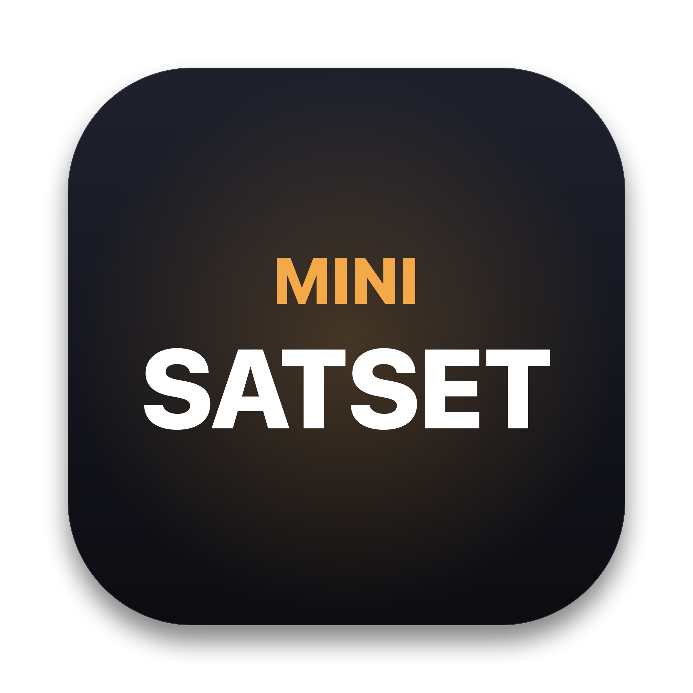

# mini-satset

<p align="center">
  
</p>

<p align="center">
  <strong>Ultra-lightweight, native macOS menu bar utility built for speed and portability.</strong><br>
  Zero external dependencies • 0.0% idle CPU • Resident RAM &lt; 12 MB • Pure Swift & AppKit
</p>

<p align="center">
  
  
  
  
  
</p>

---

## Overview

**mini-satset** is an ultra-fast, unobtrusive menu bar companion for macOS designed to replace bloated Electron utilities. It resides permanently in your status bar (`bolt.fill` + `satset`) and instantly expands upon mouse hover or spring-loaded drag, giving you frictionless access to three core productivity tools without touching your dock or taxing your system resources.

---

## Key Features

### 1. Temporary Shelf (Clipboard & Files)
- **File Staging Zone**: Hold up to 4 temporary files in a symmetrical auto-adjusting grid. Drag files directly in from Finder, or drag them out to other applications when needed.
- **Quick Text Snippets**: Store up to 4 text snippets with one-click copy, quick-paste from clipboard (`Cmd+V`), and manual addition.
- **Zero-Timer Auto-Destruct**: Items expire lazily after 5 minutes on subsequent user interactions, eliminating running countdown timers and guaranteeing **0.0% idle CPU**.

### 2. Quick File Converter
- **Native ImageIO Transcoding**: Convert images between **PNG, JPG, HEIC, WEBP, and TIFF** with hardware acceleration.
- **Strict 1:1 Pixel Protection**: Resolution is strictly preserved—never upscaled. Features quality/compression controls (*High, Medium, Compressed*).
- **Subprocess Audio Encoding**: Convert audio files between **WAV, MP3, M4A, and CAF** using macOS native CoreAudio utilities (`/usr/bin/afconvert`).
- **Single-Slot Output Shelf**: Converted file is presented in a draggable output card ready for immediate export. Conversion remains strictly locked until the slot is cleared.

### 3. Screen Color Sampler
- **Native Precision Loupe**: One-click screen pixel sampling via `NSColorSampler`.
- **Instant Clipboard Copy**: Automatically copies standard **HEX** to clipboard upon selection.
- **Format Formulations**: View real-time **HEX**, **RGB**, and **HSL** values with dedicated copy buttons.
- **Recent Swatches**: Quick-access history of your last 5 sampled colors.
- **Sampling Guard**: Hover auto-dismissal is intelligently paused while the loupe is active across monitors.

### 4. Menu Bar & System Integration
- **Zero-Delay Active Zone Monitoring**: Hover check tracks cursor presence within an expanded bounding zone, closing instantly when leaving without artificial delay.
- **Spring-Loaded Drag Expansion**: Dragging a file over the menu bar item expands the panel while respecting your active tab (dropping into Converter or Shelf accordingly).
- **Right-Click Context Menu**: Right-click the status item to toggle **Launch at Login** (`SMAppService`) or quit cleanly (`Cmd+Q`).

---

## Technical Architecture & Performance

| Metric | mini-satset | Electron / Web-based Alternatives |
| :--- | :--- | :--- |
| **Idle CPU** | **0.0%** (no background polling/timers) | 1.5% – 5.0%+ |
| **Resident RAM** | **&lt; 12 MB** | 120 MB – 350 MB+ |
| **Dependencies** | **0** (pure standard macOS SDK) | Hundreds of npm packages |
| **Binary Architecture** | **Universal 2** (`arm64` + `x86_64`) | Single arch or bloated bundle |
| **Layout Engine** | **Manual frame positioning** (0 constraint thrashing) | Web layout engine / DOM tree |
| **UI Element Policy** | `LSUIElement = true` (pure accessory app) | Mixed window policies |

---

## System Requirements

- **macOS Version**: macOS 13.0 (Ventura), macOS 14.0 (Sonoma), macOS 15.0 (Sequoia), or later.
- **Hardware**: Apple Silicon (`arm64`) or Intel (`x86_64`).

---

## Installation

### Option 1: Pre-built DMG Installer (Recommended)
1. Download `mini-satset-1.0.0.dmg` from the [Releases](#) page.
2. Open the DMG and drag **mini-satset** into your **Applications** folder.
3. Open `mini-satset` from Applications.
   > **Note on First Launch (Gatekeeper)**: Because this app is self-built without a paid Apple Developer certificate, right-click (or Control-click) `mini-satset` in Applications and select **Open**, then click **Open** in the confirmation dialog.

### Option 2: Build from Source
Ensure Xcode Command Line Tools are installed:
```bash
xcode-select --install
```

Clone the repository and build:
```bash
git clone https://github.com/your-username/mini-satset.git
cd mini-satset

# 1. Generate AppIcon.icns
make icon

# 2. Build Release App Bundle
make app

# 3. (Optional) Create DMG Installer
make dmg
```
The built application bundle will be located at `mini-satset.app`, and the installer package at `dist/mini-satset-1.0.0.dmg`.

---

## Development & Makefile Commands

```bash
make build    # Compile optimized release binary with -O -whole-module-optimization
make run      # Compile and launch directly in the terminal
make icon     # Generate 1024x1024 base PNG and compile multi-res AppIcon.icns
make app      # Assemble signed .app bundle with Info.plist and icons
make dmg      # Build Universal 2 binary and package into DMG installer
make clean    # Remove build artifacts, bundles, and temporary distribution files
```

---

## License

MIT License. Designed and built with minimalism, speed, and precision in pure Swift.
